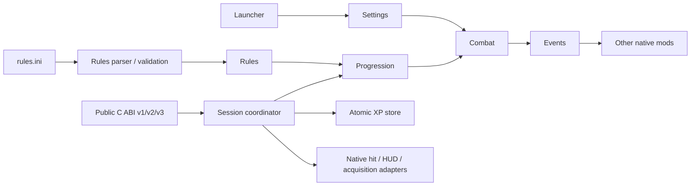

# Architecture and extension boundaries

The extension boundary is a validated data model and a versioned C service. It does not
depend on another mod's C++ classes, game-memory layout or renderer implementation.

- `rules` owns defaults, curve/reward policies and pure parsing/validation. `rules_file`
  owns filesystem access and bounded reads. Neither calls game functions.
- `progression` owns earned XP, fractions, level calculation and save-format conversion.
  Rules can change without altering the numerical XP stored in a campaign.
- `combat` observes attribution and applies the injected settings/rules. Native deaths
  and co-op confirmations use the same reward calculation.
- `ui` produces draw commands relative to existing HUD geometry. Native glyph/packet
  details stay in `native_hud`, callback ownership in `hud_bridge`.
- `native_upgrades` owns localized text bindings and acquisition lifecycle. `native_damage`
  handles the Blaster's native damage-table replacement only when its bonus is enabled.
- `native_morph_model` owns only the optional post-update held-model pose and guarded
  restoration. Native beam/targeting runs with the original basis before this adapter.
- `runtime` coordinates session/SDK lifetime. `api` implements progression/co-op contracts;
  `configuration_api` validates and commits extensions before emitting one config event.
- `store` owns locking, checksums, backups and atomic XP replacement.

To add a configuration field, extend the appropriate data policy, validate it, expose a
new versioned ABI tail if necessary, and add behavioral coverage. To add a native feature,
isolate its adapter and keep guest addresses out of public contracts. Existing ABI tables
remain unchanged; do not replace a v1/v2 function layout when adding a v3 service.

No special projectiles, cosmetic emitters or native aim overrides are part of this release.
There is no arbitrary DLL/script loader, network discovery service or general plugin registry.
Source modifications can add new policy implementations; other mods can use the data/API
extension points without rebuilding Weapon Experience. Bounds and supported weapon IDs are
explicit contracts, rather than a promise that every possible game behavior is configurable.
